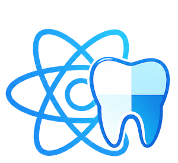
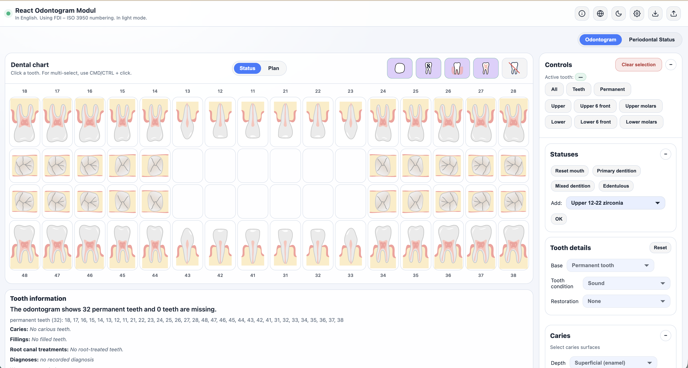
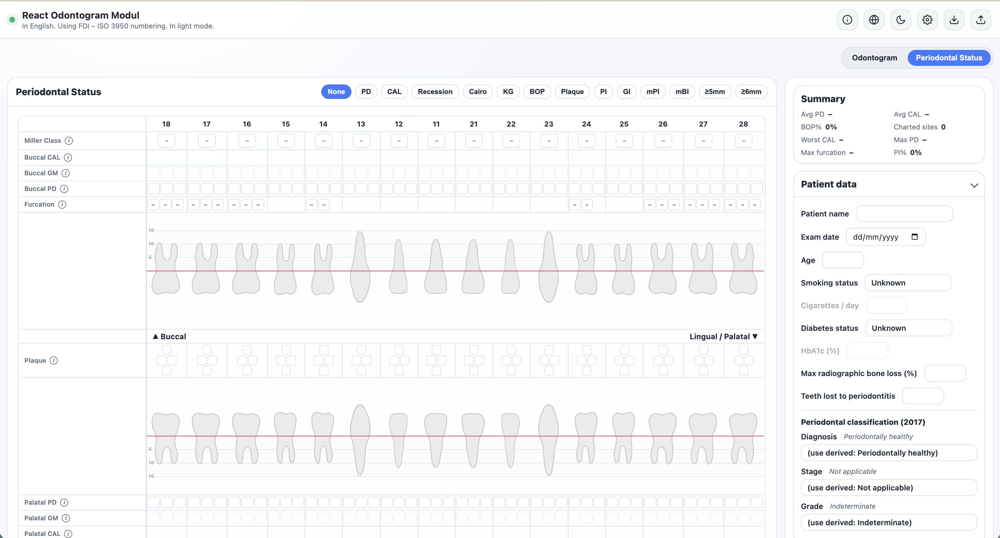

<p align="center">
  
</p>

# 🦷 Advanced Odontogram

Інтерактивний SVG-редактор **зубної формули (одонтограми)** для **React + TypeScript** — з повноцінним модулем **пародонтологічного картування**, багатоповерхневим карієсом і реставраціями, ендодонтичними та ортопедичними статусами, системами нумерації FDI / Universal / Palmer, експортом та імпортом у форматі **HL7 FHIR R4**, оцінкою за шкалою ICDAS та двомовним інтерфейсом (English, Українська)



---

## 📦 Встановлення та запуск

Проєкт є повноцінним самостійним React/TypeScript вебзастосунком на базі Vite.

### Команди для розробки та збирання:

```bash
# Запуск локального сервера розробки (Vite dev server)
npm run dev

# Збирання production-версії вебзастосунку (у папку dist/)
npm run build

# Локальний попередній перегляд зібраного вебзастосунку
npm run preview

# Запуск повного набору модульних та інтеграційних тестів (Vitest)
npm test

# Запуск браузерних E2E тестів (Playwright)
npm run test:e2e

# Перевірка типів TypeScript
npx tsc -b --noEmit

# Перевірка коду лінтером (ESLint)
npm run lint
```

---

## 🚀 Архітектура та точка входу

Точкою входу вебзастосунку є [`src/main.tsx`](src/main.tsx), який монтує кореневий компонент `App` у DOM:

```tsx
import React from "react";
import { createRoot } from "react-dom/client";
import App from "./App";
import "./index.css";

const rootEl = document.getElementById("root");
if (rootEl) {
  createRoot(rootEl).render(
    <React.StrictMode>
      <App enableNotes />
    </React.StrictMode>
  );
}
```

Усі ключові підсистеми — стоматологічна зубна формула, пародонтологічний статус (`PerioChart`), робота з пацієнтом, діагностичні класифікатори (ICD-10, SNOMED CT), імпорт та експорт (FHIR R4, PDF, SVG, растрові зображення) — інтегровані в єдиний інтерактивний вебзастосунок.

---

## 🧪 Організація тестів

Тестова інфраструктура проєкту організована за чіткими функціональними доменами у `src/__tests__/` (модульні, інтеграційні та регресійні тести Vitest) та `e2e/` (браузерні сценарії Playwright):

- `src/__tests__/core/` — клінічний рушій, анатомія зубів, нумерація, інваріанти стану, адаптація сенсорного вводу.
- `src/__tests__/caries/` — скінченний автомат карієсу, градації глибини ICDAS / CARS, відображення молочних зубів (ISO 3950).
- `src/__tests__/surfaces/` — поверхні зубів, реставрації, пломби, дефекти пломбування та системи нотації.
- `src/__tests__/diagnosis/` — діагностичні класифікатори (ICD-10, BNO, SNOMED), діагнози кейсу, перевизначення.
- `src/__tests__/perio/` — пародонтологічний рушій, вимірювання, графічні ряди, індекси (PI, GI, KG, GT, Miller, mPI, mBI, Cairo).
- `src/__tests__/fhir/` — серіалізація та десеріалізація HL7 FHIR R4, термінологія `CodeSystem` та `ValueSet`, валідація.
- `src/__tests__/plan-review/` — подвійний стан (Статус vs План), проходження змін та аналіз розбіжностей.
- `src/__tests__/ui/` — компоненти інтерфейсу, картки керування, модальні вікна та доступність (a11y).
- `src/__tests__/i18n/` — багатомовність (EN/UK), динамічне завантаження словників.
- `src/__tests__/pdf-export/` — генерація звітів PDF, SVG та растрових зображень.
- `src/__tests__/plugin/` — архітектура плагінів та ізоляція стану.
- `src/__tests__/persistence/` — збереження сесійних налаштувань у LocalStorage.
- `src/__tests__/tour/` — інтерактивний тур користувача.
- `src/__tests__/parity/` — регресійні тести та перевірка «золотих» еталонів (FHIR, SVG fingerprints, API surface).
- `src/__tests__/sprint/` — історичні регресійні сюїти, що захищають реалізовану поведінку.
- `e2e/` — наскрізні браузерні тести в реальному оточенні (Playwright).

---

## 🦷 Пародонтологічне картування



Модуль підтримує вимірювання за 6 стандартними точками на зуб: глибина зондування (PD), рівень ясенного краю (GM), кровоточивість при зондуванні (BOP), нагноєння (suppuration), розрахунок клінічного прикріплення (CAL), рецесії та загального відсотка %BOP по всій порожнині рота. 

Графічна пародонтологічна карта включає анатомічну лінію емалево-цементного з'єднання (CEJ), міліметрову координатну сітку, криві кишень/ясенного краю, ромбоподібні індексні плитки, класифікацію 2017 року та експорт у FHIR (панель LOINC `74029-0`). Доступна як перемикач вигляду `Odontogram | Periodontal Status` або як окремий компонент `PerioChart`.

---

## ✨ Ключові можливості

- 🦷 **Зубна система:** постійні, молочні, імплантати, ретеновані та відсутні зуби; субстрати зубів (природний, корінь/радікс, зламаний, підготовлений під коронку), ортопедичні реставрації (коронки, вкладки, накладки, вініри, мостоподібні протези з вибором матеріалів), знімні протези та конструкції на імплантатах.
- 🔍 **Карієс та пломби:** багатоповерхневий облік поверхонь (мезіальна, оклюзійна, дистальна, вестибулярна, оральна), шкала тяжкості ICDAS / CARS, карієс кореня та рентгенологічна глибина (E1/E2, D1–D3), класифікація дефектів пломб.
- 🏥 **Ендодонтія:** ендодонтичне лікування (лікувальні пасти, пломбування каналів, штифти), класифікація діагнозів пульпи AAE (зворотний/незворотний пульпіт, некроз), практичні латинські форми, періапікальні діагнози (гранульоми, кісти, періодонтит).
- 🩺 **Периімплантатний статус:** мукозит, градація периімплантиту (mild / moderate / severe) за консенсусом 2018 року з візуалізацією резорбції кістки.
- 🧬 **Стандарти кодування діагнозів:**
  - Базовий класифікатор ВООЗ МКХ-10 (WHO ICD-10) для кожного діагнозу.
  - Національні кодувальні пакети (BNO-10 для Угорщини, ICD-10-CM для США).
  - Опціональний оверлей SNOMED CT для клінічних понять.
  - Автоматичне формування та прив'язка ресурсів FHIR `Condition` за кодами МКХ-10.
- 🔗 **HL7 FHIR R4 та сумісність:** експорт та імпорт повного бандла FHIR R4, валідованого за офіційними правилами HL7, вбудована термінологія `CodeSystem` та `ValueSet`.
- 🔀 **Два паралельні стани (Статус vs План):** перемикання між поточним клінічним станом (`Status`) та запланованим лікуванням (`Plan`) із підсвічуванням запланованих змін пунктирним контуром та генерацією протоколу розбіжностей («Що змінюється»).
- 🖼️ **Експорт звітів:** експорт у векторний SVG, растрові PNG/JPG високої роздільної здатності, а також генерація детального багатомовного **PDF-звіту** (на базі jsPDF) з таблицею зубної формули та пародонтологічним описом.
- 🔢 **Системи нумерації:** FDI (ISO 3950), Universal (ADA) та Palmer.
- 🌐 **Двомовний інтерфейс:** повна підтримка англійської (English) та української (Українська) мов із безшовним перемиканням на льоту.
- ♿ **Доступність (a11y):** керування з клавіатури, ARIA-атрибути та підтримка сенсорного вводу для мобільних пристроїв і планшетів.

---

## 📚 Технічна документація

Повний комплект детальної інженерної та клінічної документації структуровано у каталозі [`docs/`](./docs/):

- 🏛️ [**Архітектура системи** (`docs/architecture.md`)](./docs/architecture.md) — опис шарів застосунку, взаємодія компонентів React, роль центрального координатора `src/odontogram.ts`, підсистеми стану, рендерингу та анатомічних профілів.
- 🗺️ [**Карта проєкту та підсистем** (`docs/project-map.md`)](./docs/project-map.md) — інвентар усіх директорій, підсистем та файл-за-файлом гід для швидкого пошуку модулів у кодовій базі.
- 🩺 [**Клінічна модель стану** (`docs/clinical-state.md`)](./docs/clinical-state.md) — модель подвійного стану (Статус vs План), захисний шлюз редагування (DS-1), клінічні інваріанти, пародонтологічні вимірювання, шкали 2017 року та версіонування схеми JSON (v2.19).
- 🔄 [**Життєвий цикл рушія** (`docs/engine-lifecycle.md`)](./docs/engine-lifecycle.md) — життєвий цикл `initOdontogram` / `destroyOdontogram` / `rebuildGrid`, асинхронні токени скасування (`initToken`), володіння DOM-реєстрами, не-індексна відповідність SVG-коренів та ідемпотентне зв'язування подій (`bindOnce`).
- 🧪 [**Стратегія тестування** (`docs/testing.md`)](./docs/testing.md) — структура тестових наборів Vitest, E2E тести Playwright, «золоті» еталони (заморожений API з 349 експортів, SVG fingerprints, FHIR) та команди верифікації.
- 🤖 [**Інструкція для AI-агентів** (`AGENTS.md`)](./AGENTS.md) — повний гайд для онбордингу AI-асистентів та інженерів, архітектурні інваріанти, правила безпеки та обмеження публічного API.
- 🌐 [**Національні пакети кодування** (`CODING_PACKS.md`)](./CODING_PACKS.md) — інструкція з додавання національних класифікаторів діагнозів (МКХ-10, BNO-10, ICD-10-CM, SNOMED CT).

---

## 🔌 Готовність до інтеграції з бекендом

> **Статус: ЗАПЛАНОВАНО — НЕ РЕАЛІЗОВАНО (Клієнтський режим)**  
> Вебзастосунок наразі функціонує повністю автономно в браузері пацієнта/лікаря з локальним збереженням сесії. Детальна специфікація меж інтеграції представлена в [**`docs/backend-integration-readiness.md`**](./docs/backend-integration-readiness.md).

Архітектура рушія спроєктована для безшовної інтеграції з майбутнім корпоративним бекендом (наприклад, **ASP.NET Core** з реляційною базою даних **PostgreSQL**):
1. **Канонічний JSON-документ**: метод `exportStatus()` / `collectExportPayload()` формує вичерпний серіалізований знімок одонтограми (`version: "2.19"`), що містить метадані пацієнта (`case`), глобальні налаштування, стан зубів (`teeth`) та незалежний план лікування (`plan`).
2. **Розмежування форматів**: внутрішнє збереження використовує високоточний JSON-пейлоад, тоді як обмін з медичними МІС/EMR здійснюється через стандартні бандли **HL7® FHIR® R4** (`exportFhir()`).
3. **Автозбереження**: підписка `onStateChange()` дозволяє реалізувати дебаунс-синхронізацію змін у фоновому режимі через REST API.


