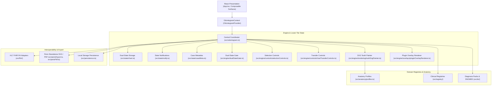

# Architecture Reference — Advanced Odontogram

## 1. Overview and Tech Stack

**Advanced Odontogram** is a standalone, client-side React and TypeScript interactive dental charting application. It provides dental formula management (restorative, endodontic, prosthetic, surgical), periodontal charting (probing depths, gingival margin, CAL, furcation, mobility, Cairo recession, 2017 classification), dual-state treatment planning (Status vs. Plan), national coding pack overlays (ICD-10, BNO-10, ICD-10-CM, SNOMED CT), and standards-compliant HL7® FHIR® R4 interoperability.

### Technology Foundation
- **React 18.3**: Declarative presentation layer, UI state management, and surface composition.
- **TypeScript 5.5**: Strict typing across clinical state models, API contracts, and domain logic.
- **Vite 7.3**: Build toolchain, fast development server, and optimized code splitting.
- **Vanilla CSS**: Curated design tokens via CSS variables (`--odon-*`), dark-mode styling, responsive layouts.
- **SVG / Canvas**: Vector-based anatomical tooth rendering with per-surface interaction, client-side rasterization, and vector PDF reporting (jsPDF).

---

## 2. System Architecture

The application is structured into distinct, unidirectional layers:



---

## 3. Core Component Roles

### 3.1 React Application Shell (`src/App.tsx`, `src/OdontogramContext.tsx`)
- Mounts the `OdontogramProvider`, providing reactive session state (active language, translations, settings, card collapse state, and active tooth context).
- Exposes modular surfaces:
  - `OdontogramTopbar`: Numbering selector, undo/redo, theme switch, settings, export menu.
  - `OdontogramChartSurface`: Main interactive SVG dental grid (`#toothGrid`), zoom popover, context menu, Status/Plan toggle.
  - `ToothInfoSurface`: Active tooth overview and clinical warnings banner.
  - `ToothControlsSurface`: Declarative clinical card deck (`ToothDetailsCard`, `RootPeriodontiumCard`, `CariesCard`, `FillingsCard`, `OrthodonticsCard`, `StatusesCard`).
  - `PerioChart` & `PerioSidebar`: Standalone or inline 6-site periodontal examination grid.
  - Dialog modals: `SettingsModal`, `ExportOptionsModal`, `DualStateConfirm`, `NoteEditorModal`.

### 3.2 Imperative Engine Coordinator (`src/odontogram.ts`)
`src/odontogram.ts` serves as the centralized coordinator between DOM lifecycle, React UI updates, and domain state:
- **Why `buildGrid()` remains in `odontogram.ts`**: The tooth grid lifecycle is deeply coupled with template preloading, SVG cloning, DOM-to-tooth registry mapping, orientation transforms (mirroring/rotations), and touch gesture attachment. Retaining `buildGrid()` in the coordinator preserves strict DOM identity, avoiding circular dependencies between rendering, navigation, and gesture handlers.
- **Responsibilities**:
  - Initializes and destroys the engine (`initOdontogram`, `destroyOdontogram`).
  - Rebuilds grid on layout or profile switches (`rebuildGrid`).
  - Manages DOM registries (`toothSvgRoot`, `toothTile`, `toothLabelUpper`, `toothLabelLower`, `pluginOverlays`).
  - Delegates selection controls to `src/engine/controls/selectionControls.ts`.
  - Delegates import/export controls to `src/engine/controls/chartTransferControls.ts`.
  - Bridges state notifications to UI redraws (`notifyStateChange`).

### 3.3 Domain State Modules (`src/state/`)
- `src/state/chart.ts`: Holds the dual `charts.status` and `charts.plan` Maps. Maintains `toothState` as a live reassignable alias to the active chart. Manages chart switching (`setChartMode`), lazy plan cloning (`cloneChart`), and plan edit tracking.
- `src/state/payload.ts`: Serialization (`serializeState`) and hydration (`hydrateState`) conforming to the official payload schema.
- `src/state/notify.ts`: Event subscription mechanism (`onStateChange`) and post-notification hooks.
- `src/state/caseMeta.ts`: Case-level metadata (patient demographics, smoking, diabetes, clinician diagnosis overrides).
- `src/state/history.ts`: Undo and redo tracking for clinical transactions.

### 3.4 Safety-Critical Dual-State Gate (`src/engine/dualStateGate.ts`)
- Governs all interactive clinical mutations via `gateToothEdit` and `gateToothEditBatch`.
- Prevents accidental overwrites between baseline findings (Status) and proposed treatment (Plan).
- Prompts clinicians via `DualStateConfirm` when modifying teeth that have already been edited in Plan mode.

### 3.5 Rendering & Visualization (`src/engine/rendering/`, `src/engine/overlays/`)
- `toothSvgPainter.ts`: Pure functional SVG styling. Sets layer visibility (`display: none` vs. active), opacity, CSS classes, and cause-specific discoloration fills.
- `pluginOverlayRenderer.ts`: Injects third-party SVG plugin overlays with security sanitization (`sanitizePluginSvg`) and strict z-layer ordering across multiple SVG roots.
- `bridgeOverlay.ts`: Arch-aware SVG bridge connectors spanning across adjacent teeth and pontics.

### 3.6 Anatomy Profiles (`src/anatomy/profiles.ts`)
- **Classic**: Uniform 16-column grid; identical SVG templates for upper and lower occlusal views.
- **Measured**: Proportional anatomical widths; separate artwork for upper and lower arches; optional deciduous (milk) tooth artwork mapped onto permanent FDI positions; lazy-loaded as an independent 3.6 MB chunk (`measured.ts`).

---

## 4. Key Directories

```text
src/
├── anatomy/          # Anatomy profile specifications (classic & measured)
├── assets/           # Tooth SVGs, icons, and graphic assets
├── dx/               # Diagnosis codes, national coding packs (BNO-10, ICD-10-CM), SNOMED CT
├── engine/           # Imperative engine subsystems
│   ├── controls/     # Extracted UI button controllers (selection, transfer)
│   ├── gestures/     # Touch gestures, pinch zoom, context menus
│   ├── indicators/   # Surface depth and defect indicators
│   ├── navigation/   # Keyboard and tile navigation
│   ├── overlays/     # Plugin SVG overlay renderer
│   └── rendering/    # SVG tooth painter and layer controllers
├── fhir/             # HL7 FHIR R4 Bundle builders, validators, and parsers
├── i18n/             # Localization engine and dictionary chunks (en, uk)
├── registry/         # Clinical enums, axis definitions, and option mappings
├── state/            # Clinical domain state, dual charts, payload serialization
├── __tests__/        # Vitest modular regression and parity test suites
├── odontogram.ts     # Engine lifecycle and DOM coordinator
├── App.tsx           # React root shell component
└── main.tsx          # Browser entry point
```

---

## 5. Future Backend Integration Readiness

> [!NOTE]
> **Status: PLANNED — NOT IMPLEMENTED**
> The application is currently 100% client-side. The architecture has been deliberately prepared for integration with an enterprise backend (such as ASP.NET Core with PostgreSQL).

### 5.1 Frontend State Ownership & API Boundaries
When integrating with a remote backend, the following architectural invariants must be preserved:
1. **Client-Side Session Authority**: Interactive charting, instant undo/redo, validation rules, and tooth selection remain client-side for zero-latency clinical charting.
2. **Standardized Native Payload**:
   - The native payload produced by `collectExportPayload()` / `exportStatus()` represents the canonical database storage document.
   - Contains `version: "2.19"`, `globals`, `case`, `teeth`, and optional `plan`.
3. **Status vs. Plan Persistence**:
   - The backend data model should support both a single-document JSON snapshot and relational tables if individual tooth queries are needed.
   - The `plan` record must remain nullable: when absent, the treatment plan is uninitialized.
4. **Native Payload vs. HL7 FHIR R4**:
   - Native JSON payload is the high-fidelity internal schema (captures precise UI settings, detailed surface geometry, and local application states).
   - HL7 FHIR R4 Bundle (exported via `exportFhir()`) is the clinical interoperability format designed for EHR/EMR exchange (LOINC `74029-0` for periodontal panels, `Condition` for diagnoses).
5. **Notification Hooks for Auto-Save**:
   - `onStateChange()` provides the hook for debounced remote synchronization.
   - External systems must serialize via `collectExportPayload()` and restore via `importStatus(jsonString)`.
