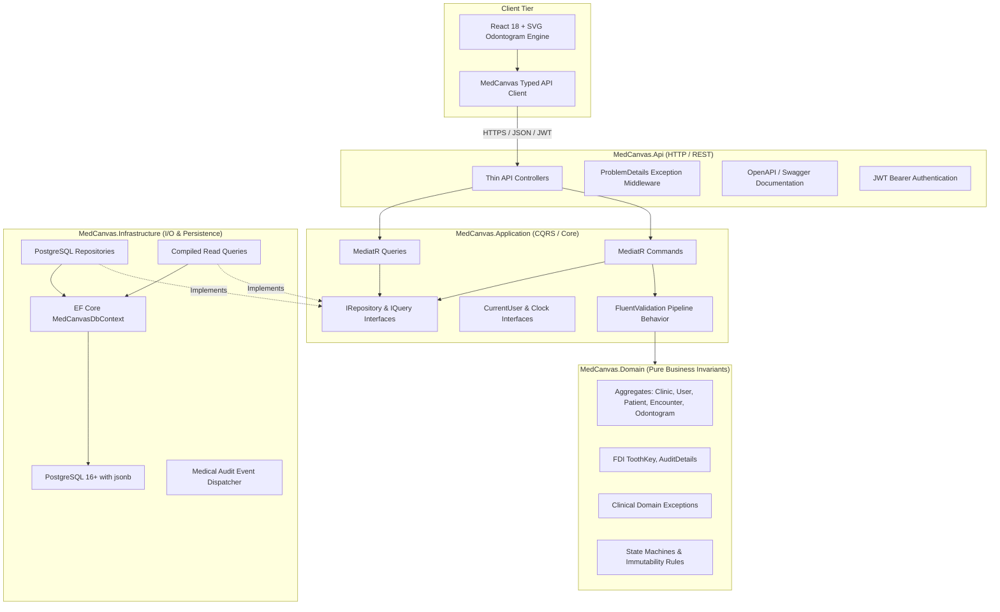

# MedCanvas Backend Architecture & Clean Design Specification

> **Document Status:** Architectural Specification  
> **Target Framework:** .NET 10 LTS (C# 13) / ASP.NET Core Web API  
> **Database:** PostgreSQL with `jsonb` / EF Core & Npgsql  
> **Primary Architectural Reference:** `notes/` reference backend audit (`docs/backend/reference-audit.md`)

---

## 1. Architectural Vision & System Boundary

The **MedCanvas Backend** is a high-reliability, modular monolith designed for dental healthcare practitioners. It provides enterprise clinic tenant isolation, patient demographics, clinical encounters, canonical odontogram persistence (with 100% Status/Plan fidelity via PostgreSQL `jsonb`), immutable revision histories, medical audit trails, and HL7® FHIR® R4 export interoperability.



---

## 2. Layer Responsibilities & Strict Dependency Invariants

The backend strictly conforms to Clean Architecture and onion dependency directions:

```text
MedCanvas.Domain           (Zero external dependencies)
       ▲
       │
MedCanvas.Application      (Depends ONLY on Domain)
       ▲
       │
MedCanvas.Infrastructure   (Depends on Application & Domain)
       ▲
       │
MedCanvas.Api              (Depends on Application & Infrastructure for DI wiring)
```

### 2.1 MedCanvas.Domain
- **Purity**: Zero third-party dependencies (no EF Core, no MediatR, no ASP.NET Core).
- **Contents**:
  - Aggregate Roots: `Clinic`, `User`, `ClinicMembership`, `Patient`, `DentalEncounter`, `OdontogramRecord`, `OdontogramRevision`, `ClinicalAuditEvent`.
  - Invariants: Protected constructors, domain factories, private setters, rich domain methods.
  - Exceptions: Specific domain exceptions (`RecordFinalizedException`, `InvalidFdiCoordinateException`, `ConcurrencyConflictException`).
  - Immutability: Finalized records are sealed against modification.

### 2.2 MedCanvas.Application
- **Responsibility**: Use case orchestration via CQRS (Command Query Responsibility Segregation) pattern.
- **Dependencies**: `MediatR`, `FluentValidation`.
- **Pipeline Behaviors**:
  - `ValidationBehavior<TRequest, TResponse>`: Automatically executes FluentValidation validators before entering handlers. Throws `ValidationException` which maps to RFC 7807 `400 Bad Request`.
  - `LoggingBehavior<TRequest, TResponse>`: Structured telemetry without logging PHI.
  - `TransactionBehavior<TRequest, TResponse>`: Atomic unit-of-work commit across aggregate boundaries.
- **Abstractions**: `IMedCanvasDbContext`, `IOdontogramRepository`, `IPatientRepository`, `ICurrentUserContext`, `IDateTimeProvider`.

### 2.3 MedCanvas.Infrastructure
- **Responsibility**: Concrete external systems, database persistence, and I/O.
- **Dependencies**: `Microsoft.EntityFrameworkCore`, `Npgsql.EntityFrameworkCore.PostgreSQL`, `System.IdentityModel.Tokens.Jwt`.
- **Key Components**:
  - `MedCanvasDbContext`: Explicit entity configurations using `IEntityTypeConfiguration<T>`.
  - JSONB Mappings: PostgreSQL `jsonb` column for `OdontogramRecord.SnapshotJson` ensuring zero schema drift.
  - Repositories & Compiled Read Queries: Optimized queries filtering by `ClinicId` for tenant isolation.
  - Interceptors: Automatic `CreatedAtUtc`, `UpdatedAtUtc`, and row version increments.

### 2.4 MedCanvas.Api
- **Responsibility**: HTTP request handling, serialization, authentication, and status codes.
- **Dependencies**: `Microsoft.AspNetCore.Authentication.JwtBearer`, `Swashbuckle.AspNetCore`.
- **Design Rules**:
  - Controllers are strictly thin: extract claims, map DTO to Command/Query, dispatch via `ISender`, return `Ok`, `CreatedAtAction`, or structured `ProblemDetails`.
  - Global `ExceptionHandlingMiddleware`: Centralized mapping of Domain, Validation, and Concurrency exceptions to RFC 7807 ProblemDetails.
  - Explicit Dependency Injection modules: `AddApplicationServices()`, `AddInfrastructureServices()`, `AddApiSecurity()`.

---

## 3. Technology Stack & Packages

| Component | Framework / Library | Target Version |
|---|---|---|
| Runtime | .NET LTS | `net10.0` |
| Web Framework | ASP.NET Core Web API | `10.0.*` |
| ORM | Entity Framework Core | `10.0.*` |
| Database Driver | Npgsql.EntityFrameworkCore.PostgreSQL | `10.0.*` |
| Mediator | MediatR | `12.4.*` |
| Validation | FluentValidation.AspNetCore | `11.9.*` |
| Testing Framework | xUnit | `2.9.*` |
| Test Mocking | NSubstitute / FluentAssertions | `5.3.*` / `7.0.*` |
| Container Testing | Testcontainers.PostgreSql | `4.1.*` (pinned `postgres:16-alpine`) |
| Integration Testing | Microsoft.AspNetCore.Mvc.Testing | `10.0.*` |

---

## 4. Architectural Improvements over Reference Backend

| Dimension | Reference Backend (`notes/`) | MedCanvas Backend |
|---|---|---|
| **CORS Policy** | Unrestricted origin predicate with credentials (`AllowAll`) | Strictly whitelisted origins, zero wildcard credentials |
| **Endpoint Auth** | `[Authorize]` absent on all controllers | Strict JWT Bearer `[Authorize]` with role & tenant policies |
| **Error Format** | Raw anonymous JSON objects, unhandled 500s | Standardized RFC 7807 ProblemDetails |
| **Database Seeding** | Auto-migrates and seeds production DB on app boot | Controlled migration execution via CLI/CI pipeline |
| **Testcontainers** | Floating `postgres:latest` image | Pinned `postgres:16-alpine` |
| **Concurrency** | TOCTOU race conditions without row locking | Optimistic concurrency via `ConcurrencyVersion` & ETag |
| **Clinical Payload** | Flat relational columns (factory entities) | Hybrid relational envelope + PostgreSQL `jsonb` snapshot |
| **Audit Trail** | None | Append-only `ClinicalAuditEvent` log |
