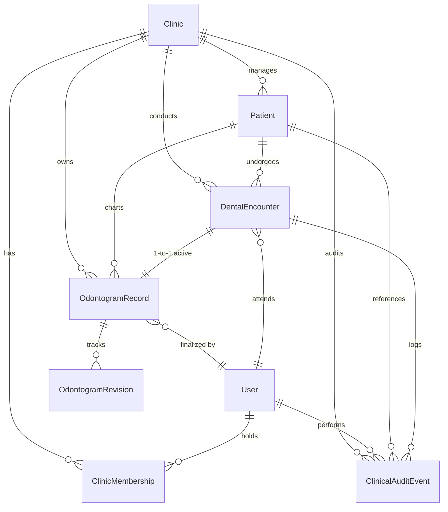

# MedCanvas PostgreSQL Data Model & Entity Specifications

> **Document Status:** Database Architecture Specification  
> **Target Database Engine:** PostgreSQL 16+  
> **ORM:** Entity Framework Core 10 (Npgsql Provider)  
> **Storage Strategy:** Relational Envelope + PostgreSQL `jsonb` Canonical Snapshot

---

## 1. Entity-Relationship Diagram (ERD)

---

## 2. Table Specifications & Constraints

### 2.1 `Clinics`
Represents the top-level multi-tenant boundary. All patient and medical data belongs to an isolated Clinic.

| Column | Type | Nullable | Constraints & Defaults |
|---|---|---|---|
| `Id` | `uuid` | No | Primary Key |
| `Name` | `varchar(200)` | No | Clinic legal display name |
| `Identifier` | `varchar(50)` | No | Unique tenant code (e.g. `CLINIC-001`) |
| `IsActive` | `boolean` | No | Default: `true` |
| `CreatedAtUtc` | `timestamptz` | No | UTC timestamp |
| `UpdatedAtUtc` | `timestamptz` | No | UTC timestamp |

**Indexes**:
- `UX_Clinics_Identifier` (Unique on `Identifier`)

---

### 2.2 `Users` & `ClinicMemberships`
Practitioners, assistants, and administrators accessing the system.

#### `Users` Table
| Column | Type | Nullable | Constraints |
|---|---|---|---|
| `Id` | `uuid` | No | Primary Key |
| `Email` | `varchar(256)` | No | Normalized unique email |
| `FullName` | `varchar(200)` | No | Clinician full name |
| `PasswordHash` | `varchar(500)` | No | PBKDF2/Argon2 password hash |
| `IsActive` | `boolean` | No | Default: `true` |
| `CreatedAtUtc` | `timestamptz` | No | UTC timestamp |
| `UpdatedAtUtc` | `timestamptz` | No | UTC timestamp |

**Indexes**:
- `UX_Users_Email` (Unique on `Email`)

#### `ClinicMemberships` Table
Maps users to clinics with role-based permissions (`Clinician`, `ClinicAdmin`, `Assistant`).
| Column | Type | Nullable | Constraints |
|---|---|---|---|
| `Id` | `uuid` | No | Primary Key |
| `ClinicId` | `uuid` | No | FK -> `Clinics(Id)` ON DELETE RESTRICT |
| `UserId` | `uuid` | No | FK -> `Users(Id)` ON DELETE CASCADE |
| `Role` | `varchar(50)` | No | `Clinician`, `ClinicAdmin`, `Assistant` |
| `IsActive` | `boolean` | No | Default: `true` |
| `CreatedAtUtc` | `timestamptz` | No | UTC timestamp |

**Indexes**:
- `UX_ClinicMemberships_Clinic_User` (Unique composite on `(ClinicId, UserId)`)

---

### 2.3 `Patients`
Represents dental patients under a specific clinic's care.

| Column | Type | Nullable | Constraints |
|---|---|---|---|
| `Id` | `uuid` | No | Primary Key |
| `ClinicId` | `uuid` | No | FK -> `Clinics(Id)` ON DELETE RESTRICT |
| `ExternalMedicalRecordNumber` | `varchar(100)` | Yes | Patient MRN / Clinic chart # |
| `FirstName` | `varchar(100)` | No | Patient first name |
| `LastName` | `varchar(100)` | No | Patient surname |
| `DateOfBirth` | `date` | Yes | Date of birth |
| `Gender` | `varchar(20)` | Yes | `Male`, `Female`, `Other`, `Unknown` |
| `Phone` | `varchar(50)` | Yes | Contact phone |
| `Email` | `varchar(256)` | Yes | Contact email |
| `MedicalAlerts` | `text` | Yes | Allergies, systemic conditions, alerts |
| `IsActive` | `boolean` | No | Default: `true` |
| `CreatedAtUtc` | `timestamptz` | No | UTC timestamp |
| `UpdatedAtUtc` | `timestamptz` | No | UTC timestamp |

**Indexes**:
- `UX_Patients_Clinic_MRN` (Unique conditional index on `(ClinicId, ExternalMedicalRecordNumber)` where not null)
- `IX_Patients_Clinic_Name` (Index on `(ClinicId, LastName, FirstName)`)

---

### 2.4 `DentalEncounters`
Clinical appointment / consultation instance during which examination and charting occur.

| Column | Type | Nullable | Constraints |
|---|---|---|---|
| `Id` | `uuid` | No | Primary Key |
| `ClinicId` | `uuid` | No | FK -> `Clinics(Id)` ON DELETE RESTRICT |
| `PatientId` | `uuid` | No | FK -> `Patients(Id)` ON DELETE RESTRICT |
| `AttendingUserId` | `uuid` | No | FK -> `Users(Id)` ON DELETE RESTRICT |
| `EncounterDateUtc` | `timestamptz` | No | Date and time of clinical session |
| `ChiefComplaint` | `text` | Yes | Patient's primary complaint |
| `ClinicalNotes` | `text` | Yes | Practitioner consultation notes |
| `Status` | `varchar(30)` | No | `Planned`, `InProgress`, `Completed`, `Cancelled` |
| `CreatedAtUtc` | `timestamptz` | No | UTC timestamp |
| `UpdatedAtUtc` | `timestamptz` | No | UTC timestamp |

**Indexes**:
- `IX_DentalEncounters_Patient` (Index on `(PatientId, EncounterDateUtc DESC)`)
- `IX_DentalEncounters_Clinic_Date` (Index on `(ClinicId, EncounterDateUtc DESC)`)

---

### 2.5 `OdontogramRecords`
The active clinical odontogram aggregate for a dental encounter.

| Column | Type | Nullable | Constraints & Invariants |
|---|---|---|---|
| `Id` | `uuid` | No | Primary Key |
| `ClinicId` | `uuid` | No | FK -> `Clinics(Id)` ON DELETE RESTRICT |
| `PatientId` | `uuid` | No | FK -> `Patients(Id)` ON DELETE RESTRICT |
| `EncounterId` | `uuid` | No | Unique FK -> `DentalEncounters(Id)` ON DELETE RESTRICT |
| `PayloadVersion` | `varchar(20)` | No | Current `"2.22"`. Minimum `"2.3.0"`. |
| `SnapshotJson` | `jsonb` | No | Canonical frontend JSON (`version`, `globals`, `teeth`, `case`, `plan`) |
| `ConcurrencyVersion` | `integer` | No | Monotonically incrementing optimistic concurrency token |
| `IsFinalized` | `boolean` | No | `true` seals record against future mutations |
| `FinalizedAtUtc` | `timestamptz` | Yes | Timestamp of clinical sign-off |
| `FinalizedByUserId` | `uuid` | Yes | FK -> `Users(Id)` ON DELETE RESTRICT |
| `CreatedAtUtc` | `timestamptz` | No | UTC timestamp |
| `UpdatedAtUtc` | `timestamptz` | No | UTC timestamp |

**Indexes & Invariants**:
- `UX_OdontogramRecords_Encounter` (Unique on `EncounterId`)
- `IX_OdontogramRecords_Patient` (Index on `(PatientId, UpdatedAtUtc DESC)`)
- `GIN_OdontogramRecords_Snapshot` (PostgreSQL GIN index on `SnapshotJson` for accelerated JSON path querying)

---

### 2.6 `OdontogramRevisions`
Immutable historical revisions of an odontogram snapshot created upon major updates or finalization.

| Column | Type | Nullable | Constraints |
|---|---|---|---|
| `Id` | `uuid` | No | Primary Key |
| `OdontogramRecordId` | `uuid` | No | FK -> `OdontogramRecords(Id)` ON DELETE CASCADE |
| `ClinicId` | `uuid` | No | FK -> `Clinics(Id)` ON DELETE RESTRICT |
| `PatientId` | `uuid` | No | FK -> `Patients(Id)` ON DELETE RESTRICT |
| `EncounterId` | `uuid` | No | FK -> `DentalEncounters(Id)` ON DELETE RESTRICT |
| `RevisionNumber` | `integer` | No | 1, 2, 3... sequential per record |
| `SnapshotJson` | `jsonb` | No | Immutable snapshot at time of revision |
| `CreatedByUserId` | `uuid` | No | FK -> `Users(Id)` ON DELETE RESTRICT |
| `CreatedAtUtc` | `timestamptz` | No | UTC timestamp |
| `ChangeSummary` | `varchar(500)` | Yes | Optional note describing reason for change |

**Indexes**:
- `UX_OdontogramRevisions_Record_Rev` (Unique on `(OdontogramRecordId, RevisionNumber)`)

---

### 2.7 `ClinicalAuditEvents`
Append-only legal medical audit log. Deletion and modification are strictly prohibited.

| Column | Type | Nullable | Constraints |
|---|---|---|---|
| `Id` | `uuid` | No | Primary Key |
| `ClinicId` | `uuid` | No | FK -> `Clinics(Id)` ON DELETE RESTRICT |
| `PatientId` | `uuid` | Yes | FK -> `Patients(Id)` ON DELETE RESTRICT |
| `EncounterId` | `uuid` | Yes | FK -> `DentalEncounters(Id)` ON DELETE RESTRICT |
| `ActorUserId` | `uuid` | No | FK -> `Users(Id)` ON DELETE RESTRICT |
| `Action` | `varchar(100)` | No | `OdontogramCreated`, `OdontogramUpdated`, `OdontogramFinalized`, `PatientViewed` |
| `ClientIpAddress` | `varchar(50)` | Yes | Client IP address |
| `DetailsHash` | `varchar(128)` | Yes | SHA-256 integrity hash of payload |
| `TimestampUtc` | `timestamptz` | No | Immutable UTC timestamp |

**Indexes**:
- `IX_ClinicalAudit_Clinic_Patient_Time` (Index on `(ClinicId, PatientId, TimestampUtc DESC)`)
