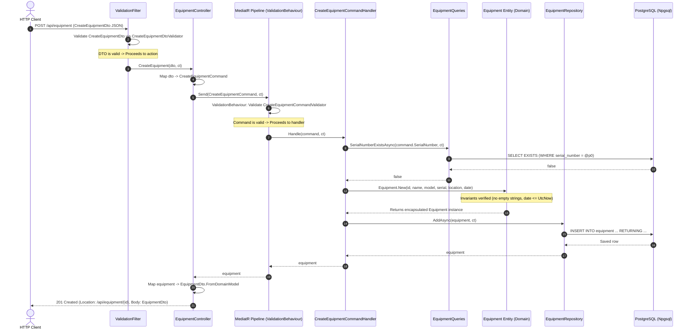

# MedCanvas — Reference Backend Architecture Audit

> **Document Version:** 1.0.0  
> **Target Date:** 2026-10-22  
> **Auditor:** Principal .NET Software Architect & Healthcare Security Engineer  
> **Source Inspected:** `E:\alina\React-Advanced-Odontogram\notes` (Reference C# / ASP.NET Core Solution)  
> **Target Solution:** MedCanvas Backend (`backend/MedCanvas.sln`, .NET 10 LTS, ASP.NET Core, PostgreSQL, EF Core)

---

## 1. Executive Summary & Audit Scope

This document provides an exhaustive, file-by-file audit of the reference backend codebase located in `notes/`. The reference codebase is an industrial maintenance management system (implementing `Equipment`, `MaintenanceSchedule`, and `WorkOrder`). 

Our objective is **not** to replicate the factory maintenance domain, but to rigorously evaluate its architectural blueprints, engineering conventions, patterns, and security postures. The positive architectural paradigms (Clean Architecture, Domain Encapsulation, CQRS via MediatR, CQS Query/Repository segregation, and real PostgreSQL integration testing via Testcontainers) will be distilled and adapted for the **MedCanvas** clinical dental backend. Crucially, the architectural weaknesses and security liabilities discovered in the reference will be explicitly documented and avoided.

### Verified File Count
A full recursive file scan of `notes/` (excluding compiler artifacts `bin/` and `obj/`) yields exactly **115 non-generated source and configuration files**:
- **Api Layer (`src/Api/`):** 31 files
- **Application Layer (`src/Application/`):** 45 files
- **Domain Layer (`src/Domain/`):** 4 files
- **Infrastructure Layer (`src/Infrastructure/`):** 21 files
- **Integration Test Harness (`tests/`):** 14 files
  - `Api.Tests.Integration`: 5 files
  - `Tests.Common`: 5 files
  - `Tests.Data`: 4 files

---

## 2. Complete File-by-File Inventory (115 Files)

| # | Relative Path | Layer / Responsibility | Key Symbols / Classes | Pattern | Validation / Persistence / Error Handling | Test Coverage | Adopt for MedCanvas? |
|---|---------------|------------------------|-----------------------|---------|-------------------------------------------|---------------|----------------------|
| 1 | `src/Domain/Domain.csproj` | Project file | Target `net9.0`, Nullable enable | Clean Architecture Core | No dependencies | N/A | **Adopt** (updated to `net10.0`) |
| 2 | `src/Domain/Entities/Equipment.cs` | Domain Aggregate | `Equipment`, `EquipmentStatus` | Factory Method, Rich Domain Model | Invariants in `New` & methods (`ArgumentException`). Private setters. | Indirect (API test) | **Adopt pattern** (use for Dental entities) |
| 3 | `src/Domain/Entities/MaintenanceSchedule.cs` | Domain Entity | `MaintenanceSchedule`, `MaintenanceFrequency` | Factory Method, Rich Domain Model | `ArgumentException` on invalid dates/strings; `Deactivate` state method. | Indirect (API test) | **Adopt pattern** |
| 4 | `src/Domain/Entities/WorkOrder.cs` | Domain Entity | `WorkOrder`, `WorkOrderPriority`, `WorkOrderStatus` | Finite State Machine, Factory Method | State transitions (`StartWork`, `Complete`, `Cancel`) throw `InvalidOperationException`. | Indirect (API test) | **Adopt pattern** (essential for Odontogram revisions) |
| 5 | `src/Application/Application.csproj` | Project file | Target `net9.0`, MediatR 13, FluentValidation 12, EF Core 9 | Application DI & Core | Depends only on Domain | N/A | **Adopt** (updated to `net10.0`) |
| 6 | `src/Application/ConfigureServices.cs` | DI Registration | `ConfigureServices.AddApplicationServices` | Service Registration Extension | Registers validators, MediatR handlers, and pipeline behaviors. | Indirect | **Adopt** |
| 7 | `src/Application/Common/Behaviours/ValidationBehaviour.cs` | MediatR Pipeline Behavior | `ValidationBehaviour<TRequest, TResponse>` | Decorator / Pipeline Interceptor | Executes all `IValidator<TRequest>`, throws `ValidationException`. | Untested unit | **Adopt & enhance** (fix exception mapping) |
| 8 | `src/Application/Common/Exceptions/ConflictException.cs` | Application Exception | `ConflictException : Exception` | Domain/Application Exception | Mapped to HTTP 409 in middleware. | Indirect | **Adopt** |
| 9 | `src/Application/Common/Settings/ApplicationSettings.cs` | Options / Settings | `ApplicationSettings`, `ConnectionStrings`, `LoggingSettings` | Strongly-Typed Options | POCO binding from `IConfiguration`. | Untested | **Adopt** |
| 10 | `src/Application/Interfaces/IApplicationDbContext.cs` | DB Abstraction | `IApplicationDbContext` | Interface Segregation | Defines `DbSet<T>` and `SaveChangesAsync`. | Mocked/Stubbed | **Adopt** |
| 11 | `src/Application/Interfaces/IEmailService.cs` | Notification Abstraction | `IEmailService` | Port / Adapter | Defines email contracts. | Mocked only | **Do NOT adopt dead code** |
| 12 | `src/Application/Interfaces/Repositories/IEquipmentRepository.cs` | Write Repository Port | `IEquipmentRepository` | CQS (Write-only Repository) | `AddAsync`, `UpdateAsync`, `DeleteAsync`. | Tested | **Adopt pattern** |
| 13 | `src/Application/Interfaces/Repositories/IMaintenanceScheduleRepository.cs` | Write Repository Port | `IMaintenanceScheduleRepository` | CQS (Write-only Repository) | `AddAsync`, `UpdateAsync`, `DeleteAsync`. | Tested | **Adopt pattern** |
| 14 | `src/Application/Interfaces/Repositories/IWorkOrderRepository.cs` | Write Repository Port | `IWorkOrderRepository` | CQS (Write-only Repository) | `AddAsync`, `UpdateAsync`, `DeleteAsync`. | Tested | **Adopt pattern** |
| 15 | `src/Application/Interfaces/Queries/IEquipmentQueries.cs` | Read Query Port | `IEquipmentQueries` | CQS (Read Query Service) | `GetAllAsync`, `GetByIdAsync`, `SerialNumberExistsAsync`. | Tested | **Adopt pattern** |
| 16 | `src/Application/Interfaces/Queries/IMaintenanceScheduleQueries.cs` | Read Query Port | `IMaintenanceScheduleQueries` | CQS (Read Query Service) | `GetAllAsync`, `GetByIdAsync`, `GetByEquipmentIdAsync`. | Tested | **Adopt pattern** |
| 17 | `src/Application/Interfaces/Queries/IWorkOrderQueries.cs` | Read Query Port | `IWorkOrderQueries` | CQS (Read Query Service) | `GetAllAsync`, `GetByIdAsync`, `GetByEquipmentIdAsync`, `GetByStatusAsync`. | Tested | **Adopt pattern** |
| 18 | `src/Application/Equipments/Commands/CreateEquipmentCommand.cs` | CQRS Command | `CreateEquipmentCommand : IRequest<Equipment>` | CQRS Command DTO | `required` init properties. | Tested | **Adopt pattern** |
| 19 | `src/Application/Equipments/Commands/CreateEquipmentCommandHandler.cs` | CQRS Command Handler | `CreateEquipmentCommandHandler` | Command Handler | Queries uniqueness, creates entity, persists via repository. | Tested | **Adopt pattern** |
| 20 | `src/Application/Equipments/Commands/UpdateEquipmentCommand.cs` | CQRS Command | `UpdateEquipmentCommand : IRequest<Equipment>` | CQRS Command DTO | Id + fields to update. | Tested | **Adopt pattern** |
| 21 | `src/Application/Equipments/Commands/UpdateEquipmentCommandHandler.cs` | CQRS Command Handler | `UpdateEquipmentCommandHandler` | Command Handler | Fetches by Id, calls `entity.UpdateDetails()`, saves. | Tested | **Adopt pattern** |
| 22 | `src/Application/Equipments/Commands/UpdateEquipmentStatusCommand.cs` | CQRS Command | `UpdateEquipmentStatusCommand : IRequest<Equipment>` | CQRS Command DTO | Id + enum status. | Tested | **Adopt pattern** |
| 23 | `src/Application/Equipments/Commands/UpdateEquipmentStatusCommandHandler.cs` | CQRS Command Handler | `UpdateEquipmentStatusCommandHandler` | Command Handler | Fetches by Id, calls `entity.ChangeStatus()`, saves. | Tested | **Adopt pattern** |
| 24 | `src/Application/Equipments/Commands/DeleteEquipmentCommand.cs` | CQRS Command | `DeleteEquipmentCommand : IRequest<Unit>` | CQRS Command DTO | Id. | Tested | **Adopt pattern** |
| 25 | `src/Application/Equipments/Commands/DeleteEquipmentCommandHandler.cs` | CQRS Command Handler | `DeleteEquipmentCommandHandler` | Command Handler | Checks child dependencies, throws `ConflictException` if active. | Tested | **Adopt with DB FKs** |
| 26 | `src/Application/MaintenanceSchedules/Commands/CreateMaintenanceScheduleCommand.cs` | CQRS Command | `CreateMaintenanceScheduleCommand : IRequest<MaintenanceSchedule>` | CQRS Command DTO | Schedule fields. | Tested | **Adopt pattern** |
| 27 | `src/Application/MaintenanceSchedules/Commands/CreateMaintenanceScheduleCommandHandler.cs` | CQRS Command Handler | `CreateMaintenanceScheduleCommandHandler` | Command Handler | Verifies equipment exists, constructs entity, saves. | Tested | **Adopt pattern** |
| 28 | `src/Application/MaintenanceSchedules/Commands/UpdateMaintenanceScheduleCommand.cs` | CQRS Command | `UpdateMaintenanceScheduleCommand : IRequest<MaintenanceSchedule>` | CQRS Command DTO | Schedule fields + Id. | Tested | **Adopt pattern** |
| 29 | `src/Application/MaintenanceSchedules/Commands/UpdateMaintenanceScheduleCommandHandler.cs` | CQRS Command Handler | `UpdateMaintenanceScheduleCommandHandler` | Command Handler | Fetches schedule, calls `entity.UpdateSchedule()`, saves. | Tested | **Adopt pattern** |
| 30 | `src/Application/MaintenanceSchedules/Commands/DeactivateMaintenanceScheduleCommand.cs` | CQRS Command | `DeactivateMaintenanceScheduleCommand : IRequest<Unit>` | CQRS Command DTO | Id. | Tested | **Adopt pattern** |
| 31 | `src/Application/MaintenanceSchedules/Commands/DeactivateMaintenanceScheduleCommandHandler.cs` | CQRS Command Handler | `DeactivateMaintenanceScheduleCommandHandler` | Command Handler | Calls `schedule.Deactivate()`, saves. | Tested | **Adopt pattern** |
| 32 | `src/Application/WorkOrders/Commands/CreateWorkOrderCommand.cs` | CQRS Command | `CreateWorkOrderCommand : IRequest<WorkOrder>` | CQRS Command DTO | Work order fields. | Tested | **Adopt pattern** |
| 33 | `src/Application/WorkOrders/Commands/CreateWorkOrderCommandHandler.cs` | CQRS Command Handler | `CreateWorkOrderCommandHandler` | Command Handler | Verifies equipment, checks duplicate number, creates & saves. | Tested | **Adopt pattern** |
| 34 | `src/Application/WorkOrders/Commands/UpdateWorkOrderCommand.cs` | CQRS Command | `UpdateWorkOrderCommand : IRequest<WorkOrder>` | CQRS Command DTO | Update fields. | Tested | **Adopt pattern** |
| 35 | `src/Application/WorkOrders/Commands/UpdateWorkOrderCommandHandler.cs` | CQRS Command Handler | `UpdateWorkOrderCommandHandler` | Command Handler | Calls `workOrder.UpdateDetails()`, saves. | Tested | **Adopt pattern** |
| 36 | `src/Application/WorkOrders/Commands/StartWorkOrderCommand.cs` | CQRS Command | `StartWorkOrderCommand : IRequest<WorkOrder>` | CQRS Command DTO | Id. | Tested | **Adopt pattern** |
| 37 | `src/Application/WorkOrders/Commands/StartWorkOrderCommandHandler.cs` | CQRS Command Handler | `StartWorkOrderCommandHandler` | Command Handler | Calls `workOrder.StartWork()`, saves. | Tested | **Adopt pattern** |
| 38 | `src/Application/WorkOrders/Commands/CompleteWorkOrderCommand.cs` | CQRS Command | `CompleteWorkOrderCommand : IRequest<WorkOrder>` | CQRS Command DTO | Id + completion notes. | Tested | **Adopt pattern** |
| 39 | `src/Application/WorkOrders/Commands/CompleteWorkOrderCommandHandler.cs` | CQRS Command Handler | `CompleteWorkOrderCommandHandler` | Command Handler | Invariant check (must be InProgress), calls `Complete()`. | Tested | **Adopt pattern** |
| 40 | `src/Application/WorkOrders/Commands/CancelWorkOrderCommand.cs` | CQRS Command | `CancelWorkOrderCommand : IRequest<WorkOrder>` | CQRS Command DTO | Id. | Tested | **Adopt pattern** |
| 41 | `src/Application/WorkOrders/Commands/CancelWorkOrderCommandHandler.cs` | CQRS Command Handler | `CancelWorkOrderCommandHandler` | Command Handler | Calls `workOrder.Cancel()`, saves. | Tested | **Adopt pattern** |
| 42 | `src/Application/Validators/CreateEquipmentCommandValidator.cs` | Command Validator | `CreateEquipmentCommandValidator` | FluentValidation | Name, Model, Serial, Location lengths; past date. | Tested | **Adopt pattern** |
| 43 | `src/Application/Validators/UpdateEquipmentCommandValidator.cs` | Command Validator | `UpdateEquipmentCommandValidator` | FluentValidation | Validates update fields. | Tested | **Adopt pattern** |
| 44 | `src/Application/Validators/CreateMaintenanceScheduleCommandValidator.cs` | Command Validator | `CreateMaintenanceScheduleCommandValidator` | FluentValidation | EquipmentId != Empty; future NextDueDate. | Tested | **Adopt pattern** |
| 45 | `src/Application/Validators/UpdateMaintenanceScheduleCommandValidator.cs` | Command Validator | `UpdateMaintenanceScheduleCommandValidator` | FluentValidation | Schedule update rules. | Tested | **Adopt pattern** |
| 46 | `src/Application/Validators/CreateWorkOrderCommandValidator.cs` | Command Validator | `CreateWorkOrderCommandValidator` | FluentValidation | WorkOrderNumber, Title, Description, Priority enum. | Tested | **Adopt pattern** |
| 47 | `src/Application/Validators/UpdateWorkOrderCommandValidator.cs` | Command Validator | `UpdateWorkOrderCommandValidator` | FluentValidation | Update rules. | Tested | **Adopt pattern** |
| 48 | `src/Application/Validators/CompleteWorkOrderCommandValidator.cs` | Command Validator | `CompleteWorkOrderCommandValidator` | FluentValidation | Id != Empty, CompletionNotes max length. | Tested | **Adopt pattern** |
| 49 | `src/Infrastructure/Infrastructure.csproj` | Project file | Target `net9.0`, Npgsql.EFCore 9.0.4 | Infrastructure Core | Depends on Application | N/A | **Adopt** (updated to `net10.0`) |
| 50 | `src/Infrastructure/ConfigureServices.cs` | DI Registration | `ConfigureServices.AddInfrastructureServices` | Service Registration Extension | Registers DbContext (Npgsql), initialiser, repositories, queries. | Tested | **Adopt** |
| 51 | `src/Infrastructure/Persistence/ApplicationDbContext.cs` | EF Core Context | `ApplicationDbContext : DbContext, IApplicationDbContext` | Unit of Work / DbContext | Applies entity configurations, converts UTC dates globally. | Tested | **Adopt & enhance** |
| 52 | `src/Infrastructure/Persistence/ApplicationDbContextInitialiser.cs` | DB Initializer & Seeder | `ApplicationDbContextInitialiser` | Migration & Seeder | `Database.MigrateAsync()`, conditional seeding if table empty. | Skipped in tests | **Do NOT run in prod** |
| 53 | `src/Infrastructure/Persistence/Configurations/EquipmentConfiguration.cs` | EF Core Mapping | `EquipmentConfiguration : IEntityTypeConfiguration<Equipment>` | Fluent API Configuration | Table `"equipment"`, column snake_case, unique serial index. | Tested | **Adopt pattern** |
| 54 | `src/Infrastructure/Persistence/Configurations/MaintenanceScheduleConfiguration.cs` | EF Core Mapping | `MaintenanceScheduleConfiguration` | Fluent API Configuration | Table `"maintenance_schedules"`, column snake_case, indexes. | Tested | **Adopt & add FK** |
| 55 | `src/Infrastructure/Persistence/Configurations/WorkOrderConfiguration.cs` | EF Core Mapping | `WorkOrderConfiguration` | Fluent API Configuration | Table `"work_orders"`, snake_case columns, indexes. | Tested | **Adopt & add FK** |
| 56 | `src/Infrastructure/Persistence/Converters/DateTimeUtcConverter.cs` | Value Converter | `DateTimeUtcConverter : ValueConverter<DateTime, DateTime>` | EF Core Value Converter | Enforces `DateTimeKind.Utc` on read/write. | Tested | **Adopt pattern** |
| 57 | `src/Infrastructure/Persistence/Migrations/20251002192217_Initial.cs` | Initial Migration | `Initial : Migration` | Schema Migration | Creates tables and indexes. | Tested | **Model for MedCanvas** |
| 58 | `src/Infrastructure/Persistence/Migrations/20251002192217_Initial.Designer.cs` | Migration Metadata | `Initial` Designer | Tool-generated | Snapshot metadata. | Tested | Auto-generated |
| 59 | `src/Infrastructure/Persistence/Migrations/20251003234507_InitialCreate.cs` | Redundant Migration | `InitialCreate : Migration` | Empty Migration | Empty Up/Down methods. | N/A | **Do NOT adopt empty migrations** |
| 60 | `src/Infrastructure/Persistence/Migrations/20251003234507_InitialCreate.Designer.cs` | Migration Metadata | `InitialCreate` Designer | Tool-generated | Snapshot metadata. | N/A | Dead code |
| 61 | `src/Infrastructure/Persistence/Migrations/20251006141913_TestPractical.cs` | Redundant Migration | `TestPractical : Migration` | Empty Migration | Empty Up/Down methods. | N/A | **Do NOT adopt** |
| 62 | `src/Infrastructure/Persistence/Migrations/20251006141913_TestPractical.Designer.cs` | Migration Metadata | `TestPractical` Designer | Tool-generated | Snapshot metadata. | N/A | Dead code |
| 63 | `src/Infrastructure/Persistence/Migrations/ApplicationDbContextModelSnapshot.cs` | Model Snapshot | `ApplicationDbContextModelSnapshot` | EF Core Snapshot | Current EF Core relational model. | Tested | Auto-generated |
| 64 | `src/Infrastructure/Persistence/Repositories/EquipmentRepository.cs` | Write Repository | `EquipmentRepository : IEquipmentRepository` | Repository | Adds, updates, deletes through `ApplicationDbContext`. | Tested | **Adopt pattern** |
| 65 | `src/Infrastructure/Persistence/Repositories/MaintenanceScheduleRepository.cs` | Write Repository | `MaintenanceScheduleRepository` | Repository | CRUD writes with `SaveChangesAsync`. | Tested | **Adopt pattern** |
| 66 | `src/Infrastructure/Persistence/Repositories/WorkOrderRepository.cs` | Write Repository | `WorkOrderRepository` | Repository | CRUD writes with `SaveChangesAsync`. | Tested | **Adopt pattern** |
| 67 | `src/Infrastructure/Persistence/Queries/EquipmentQueries.cs` | Read Query Service | `EquipmentQueries : IEquipmentQueries` | Query Object / Service | `AsNoTracking()`, `ToListAsync()`, `FirstOrDefaultAsync()`. | Tested | **Adopt pattern** |
| 68 | `src/Infrastructure/Persistence/Queries/MaintenanceScheduleQueries.cs` | Read Query Service | `MaintenanceScheduleQueries` | Query Object / Service | `AsNoTracking()`, filtered read queries. | Tested | **Adopt pattern** |
| 69 | `src/Infrastructure/Persistence/Queries/WorkOrderQueries.cs` | Read Query Service | `WorkOrderQueries` | Query Object / Service | `AsNoTracking()`, status/equipment filtering. | Tested | **Adopt pattern** |
| 70 | `src/Api/Api.csproj` | Project file | Target `net9.0`, Swashbuckle 9, OpenApi 9 | Web API Host | Depends on Application & Infrastructure | N/A | **Adopt** (updated to `net10.0`) |
| 71 | `src/Api/Api.http` | HTTP Client File | REST requests | Developer tooling | Sample HTTP requests. | N/A | **Adopt** |
| 72 | `src/Api/appsettings.json` | Configuration | Production settings | Configuration | Plaintext connection string with credentials. | N/A | **Do NOT commit passwords** |
| 73 | `src/Api/appsettings.Development.json` | Configuration | Dev overrides | Configuration | Logging overrides. | N/A | **Adopt** |
| 74 | `src/Api/Properties/launchSettings.json` | Tooling Settings | Local launch profiles | Tooling | Kestrel HTTP/HTTPS ports. | N/A | **Adopt** |
| 75 | `src/Api/Program.cs` | Bootstrap Entry | `Program` | Minimal API / Host Builder | Configures DI, Swagger, pipeline, DB initialization, CORS. | Integration tests | **Adopt & secure** |
| 76 | `src/Api/Modules/SetupModule.cs` | API Setup Module | `SetupModule` | Modular Extension | Sets up Controllers, Filters, CORS, DTO validators. | Tested | **Adopt & restrict CORS** |
| 77 | `src/Api/Middleware/ExceptionHandlingMiddleware.cs` | Error Handling | `ExceptionHandlingMiddleware` | Global Exception Filter | Maps `ConflictException` (409), `KeyNotFound` (404), `InvalidOperation` (400). | Tested | **Adopt & standardize RFC 7807** |
| 78 | `src/Api/Filters/ValidationFilter.cs` | Action Filter | `ValidationFilter : IAsyncActionFilter` | MVC Filter | Intercepts DTO before action, returns `ValidationProblemDetails` 400. | Tested | **Adopt pattern** |
| 79 | `src/Api/Controllers/EquipmentController.cs` | Web API Controller | `EquipmentController : ControllerBase` | REST Controller | Thin endpoints delegating to MediatR and queries. | Fully tested | **Adopt pattern** |
| 80 | `src/Api/Controllers/MaintenanceSchedulesController.cs` | Web API Controller | `MaintenanceSchedulesController` | REST Controller | Schedule endpoints delegating to MediatR/queries. | Fully tested | **Adopt pattern** |
| 81 | `src/Api/Controllers/WorkOrdersController.cs` | Web API Controller | `WorkOrdersController` | REST Controller | Work order lifecycle endpoints. | Fully tested | **Adopt pattern** |
| 82 | `src/Api/DTOs/Equipment/CreateEquipmentDto.cs` | Request DTO | `CreateEquipmentDto(record)` | Data Transfer Object | Positional record for request body. | Tested | **Adopt pattern** |
| 83 | `src/Api/DTOs/Equipment/UpdateEquipmentDto.cs` | Request DTO | `UpdateEquipmentDto(record)` | Data Transfer Object | Positional record for update body. | Tested | **Adopt pattern** |
| 84 | `src/Api/DTOs/Equipment/UpdateEquipmentStatusDto.cs` | Request DTO | `UpdateEquipmentStatusDto(record)` | Data Transfer Object | Status update body. | Tested | **Adopt pattern** |
| 85 | `src/Api/DTOs/Equipment/EquipmentDto.cs` | Response DTO | `EquipmentDto(record)` | Data Transfer Object | Maps domain model via `FromDomainModel` factory. | Tested | **Adopt pattern** |
| 86 | `src/Api/DTOs/MaintenanceSchedule/CreateMaintenanceScheduleDto.cs` | Request DTO | `CreateMaintenanceScheduleDto(record)` | Data Transfer Object | Schedule creation payload. | Tested | **Adopt pattern** |
| 87 | `src/Api/DTOs/MaintenanceSchedule/UpdateMaintenanceScheduleDto.cs` | Request DTO | `UpdateMaintenanceScheduleDto(record)` | Data Transfer Object | Schedule update payload. | Tested | **Adopt pattern** |
| 88 | `src/Api/DTOs/MaintenanceSchedule/MaintenanceScheduleDto.cs` | Response DTO | `MaintenanceScheduleDto(record)` | Data Transfer Object | Domain mapping via `FromDomainModel`. | Tested | **Adopt pattern** |
| 89 | `src/Api/DTOs/WorkOrder/CreateWorkOrderDto.cs` | Request DTO | `CreateWorkOrderDto(record)` | Data Transfer Object | Work order payload. | Tested | **Adopt pattern** |
| 90 | `src/Api/DTOs/WorkOrder/UpdateWorkOrderDto.cs` | Request DTO | `UpdateWorkOrderDto(record)` | Data Transfer Object | Update payload. | Tested | **Adopt pattern** |
| 91 | `src/Api/DTOs/WorkOrder/CompleteWorkOrderDto.cs` | Request DTO | `CompleteWorkOrderDto(record)` | Data Transfer Object | Completion notes payload. | Tested | **Adopt pattern** |
| 92 | `src/Api/DTOs/WorkOrder/WorkOrderDto.cs` | Response DTO | `WorkOrderDto(record)` | Data Transfer Object | Domain mapping via `FromDomainModel`. | Tested | **Adopt pattern** |
| 93 | `src/Api/Validators/CreateEquipmentDtoValidator.cs` | HTTP DTO Validator | `CreateEquipmentDtoValidator` | FluentValidation | Lengths, required fields, date constraints. | Tested | **Adopt pattern** |
| 94 | `src/Api/Validators/UpdateEquipmentDtoValidator.cs` | HTTP DTO Validator | `UpdateEquipmentDtoValidator` | FluentValidation | Name, model, location rules. | Tested | **Adopt pattern** |
| 95 | `src/Api/Validators/UpdateEquipmentStatusDtoValidator.cs` | HTTP DTO Validator | `UpdateEquipmentStatusDtoValidator` | FluentValidation | Status enum string validation. | Tested | **Adopt pattern** |
| 96 | `src/Api/Validators/CreateMaintenanceScheduleDtoValidator.cs` | HTTP DTO Validator | `CreateMaintenanceScheduleDtoValidator` | FluentValidation | EquipmentId, task name, future date. | Tested | **Adopt pattern** |
| 97 | `src/Api/Validators/UpdateMaintenanceScheduleDtoValidator.cs` | HTTP DTO Validator | `UpdateMaintenanceScheduleDtoValidator` | FluentValidation | Schedule update rules. | Tested | **Adopt pattern** |
| 98 | `src/Api/Validators/CreateWorkOrderDtoValidator.cs` | HTTP DTO Validator | `CreateWorkOrderDtoValidator` | FluentValidation | Number, priority, description rules. | Tested | **Adopt pattern** |
| 99 | `src/Api/Validators/UpdateWorkOrderDtoValidator.cs` | HTTP DTO Validator | `UpdateWorkOrderDtoValidator` | FluentValidation | Title, description, date rules. | Tested | **Adopt pattern** |
| 100 | `src/Api/Validators/CompleteWorkOrderDtoValidator.cs` | HTTP DTO Validator | `CompleteWorkOrderDtoValidator` | FluentValidation | Completion notes length rule. | Tested | **Adopt pattern** |
| 101 | `tests/Tests.Common/Tests.Common.csproj` | Test Infrastructure Project | `net9.0`, Testcontainers.PostgreSql 4.8.1, xUnit 2.9.2 | Test Support Harness | References `Api` & `Infrastructure` | N/A | **Adopt** (updated to `net10.0`) |
| 102 | `tests/Tests.Common/IntegrationTestWebFactory.cs` | WebApplicationFactory | `IntegrationTestWebFactory : WebApplicationFactory<Program>, IAsyncLifetime` | Test Fixture | Spins up Docker PostgreSQL container, runs migrations, overrides services. | Used by all integration tests | **Adopt & pin container tag** |
| 103 | `tests/Tests.Common/BaseIntegrationTest.cs` | Base Test Class | `BaseIntegrationTest : IClassFixture<IntegrationTestWebFactory>` | Test Base | Provides `Client`, `Context`, `SaveChangesAsync`. | Used by all integration tests | **Adopt pattern** |
| 104 | `tests/Tests.Common/TestExtensions.cs` | Test Helpers | `TestExtensions`, `TestAuthHandler` | Test Helper | Helper `ToResponseModel<T>`, injects mock `TestScheme` auth. | Used across tests | **Adopt & enhance** |
| 105 | `tests/Tests.Common/Services/InMemoryEmailService.cs` | Test Stub | `InMemoryEmailService : IEmailService` | Test Double / Spy | Stores sent emails in memory list. | Untested | **Adopt pattern when needed** |
| 106 | `tests/Tests.Data/Tests.Data.csproj` | Test Data Project | `net9.0` | Test Fixtures | References `Api` & `Domain` | N/A | **Adopt** (updated to `net10.0`) |
| 107 | `tests/Tests.Data/Equipment/EquipmentData.cs` | Test Data Factory | `EquipmentData` | Object Mother / Test Builder | Creates deterministic test entities and DTOs. | Used by tests | **Adopt pattern** |
| 108 | `tests/Tests.Data/MaintenanceSchedules/MaintenanceSchedulesData.cs` | Test Data Factory | `MaintenanceSchedulesData` | Object Mother / Test Builder | Creates deterministic schedule test fixtures. | Used by tests | **Adopt pattern** |
| 109 | `tests/Tests.Data/WorkOrders/WorkOrdersData.cs` | Test Data Factory | `WorkOrdersData` | Object Mother / Test Builder | Creates deterministic work order test fixtures. | Used by tests | **Adopt pattern** |
| 110 | `tests/Api.Tests.Integration/Api.Tests.Integration.csproj` | Integration Test Project | `net9.0`, FluentAssertions 8.7.1, coverlet.collector | Test Runner | References `Tests.Common` & `Tests.Data` | N/A | **Adopt** (updated to `net10.0`) |
| 111 | `tests/Api.Tests.Integration/UnitTest1.cs` | Empty Test File | `UnitTest1` | Blank Template | Blank `[Fact] public void Test1()` | Empty | **Do NOT adopt dead files** |
| 112 | `tests/Api.Tests.Integration/Equipment/EquipmentControllerTests.cs` | Controller Integration Tests | `EquipmentControllerTests` | HTTP API Test with DB | Tests GET, POST, PUT, PATCH, DELETE + validations. | 11 test cases | **Adopt pattern** |
| 113 | `tests/Api.Tests.Integration/MaintenanceSchedules/MaintenanceSchedulesControllerTests.cs` | Controller Integration Tests | `MaintenanceSchedulesControllerTests` | HTTP API Test with DB | Tests schedule CRUD and equipment queries. | 9 test cases | **Adopt pattern** |
| 114 | `tests/Api.Tests.Integration/WorkOrders/WorkOrdersControllerTests.cs` | Controller Integration Tests | `WorkOrdersControllerTests` | HTTP API Test with DB | Tests work order lifecycle, start, complete, cancel. | 14 test cases | **Adopt pattern** |
| 115 | `tests/Api.Tests.Integration/Relationships/EntityRelationshipsTests.cs` | Aggregate Relationship Tests | `EntityRelationshipsTests` | Relationship & Cascade Verification | Tests cross-entity integrity, deletion conflict, cascading. | 6 test cases | **Adopt pattern** |

---

## 3. Reference Architecture Analysis & Evidence

### 3.1 Clean Architecture Dependency Direction
The reference project follows strict onion / clean architecture layering:
```
           ┌───────────────────────────────────────┐
           │               src/Api                 │
           │  (Controllers, DTOs, Filters, Module) │
           └───────────┬───────────────────────┬───┘
                       │                       │
                       ▼                       ▼
           ┌───────────────────────┐   ┌───────────────────────┐
           │    src/Application    │◄──┤  src/Infrastructure   │
           │ (CQRS, Validation, DI)│   │ (EF Core, Repos, Npgsql)
           └───────────┬───────────┘   └───────────────────────┘
                       │
                       ▼
           ┌───────────────────────┐
           │      src/Domain       │
           │(Entities, Enums, Rules│
           └───────────────────────┘
```
1. **Domain** has **zero** package dependencies and references no other projects. It contains pure business logic (`Equipment`, `WorkOrder`, `MaintenanceSchedule`).
2. **Application** references only **Domain**. It defines interfaces (`IApplicationDbContext`, `IEquipmentRepository`, `IEquipmentQueries`), commands, handlers, and validators.
3. **Infrastructure** references **Application** and implements the interfaces using EF Core and Npgsql PostgreSQL.
4. **Api** references **Application** and **Infrastructure**, serving as the composition root (`Program.cs`) and HTTP adapter.

### 3.2 Command-Query Segregation (CQS) at Persistence Level
Instead of a generic repository anti-pattern, the reference splits persistence into two dedicated interfaces for each aggregate:
- **Write Repository (`IEquipmentRepository`)**: Encapsulates state-changing mutations (`AddAsync`, `UpdateAsync`, `DeleteAsync`).
- **Read Queries (`IEquipmentQueries`)**: Optimized for querying without entity tracking overhead (`AsNoTracking()`). Queries return read-only models directly.

### 3.3 FluentValidation at Two Distinct Boundaries
The reference implements two tiers of validation:
1. **HTTP DTO Boundary (`ValidationFilter`)**: An `IAsyncActionFilter` inspects incoming request DTOs (`ActionArguments`). If an `IValidator<TDto>` exists in DI, it executes before the controller action is invoked. If invalid, it returns `ValidationProblemDetails` (HTTP 400) immediately.
2. **Application Command Boundary (`ValidationBehaviour`)**: A MediatR pipeline behavior inspects `CreateEquipmentCommand`. It ensures that even if a command is dispatched internally (not via HTTP), business constraints are validated, throwing `ValidationException`.

---

## 4. End-to-End Tracing of Reference Operations

### Operation 1: Successful Create Request (`POST /api/equipment`)


### Operation 2: State Transition Request (`PATCH /api/work-orders/{id}/start`)
1. **HTTP Request:** Client sends `PATCH /api/work-orders/01931a.../start`.
2. **Controller:** `WorkOrdersController.StartWorkOrder` receives Guid `id`. No request body. Constructs `StartWorkOrderCommand { Id = id }`.
3. **MediatR Pipeline:** Dispatches through `ValidationBehaviour`.
4. **Handler Execution:** `StartWorkOrderCommandHandler.Handle` calls `IWorkOrderQueries.GetByIdAsync(id)`.
5. **Database Read:** EF Core queries `work_orders` table with `.AsNoTracking()`. If null, throws `KeyNotFoundException`.
6. **Domain Transition:** Handler calls domain method `workOrder.StartWork()`.
   - Domain invariant check: `if (Status != WorkOrderStatus.Open) throw new InvalidOperationException("Only open work orders can be started");`
   - State mutation: `Status = WorkOrderStatus.InProgress; UpdatedAt = DateTime.UtcNow;`
7. **Persistence:** Handler calls `IWorkOrderRepository.UpdateAsync(workOrder)`.
8. **HTTP Response:** Returns `200 OK` with updated `WorkOrderDto`.

### Operation 3: Failed Validation & Business Conflict Scenarios
1. **Failed HTTP Validation:** If client sends `POST /api/equipment` with `{"name": ""}`:
   - `ValidationFilter` intercepts before controller.
   - `CreateEquipmentDtoValidator` flags `Name is required`.
   - Returns RFC 7807 `ValidationProblemDetails` (HTTP 400) immediately without touching controller or database.
2. **Failed Domain Business Rule (Conflict):** If client sends `DELETE /api/equipment/{id}` while equipment has open work orders:
   - `DeleteEquipmentCommandHandler` checks `_workOrderQueries.GetByStatusAsync`.
   - Identifies active work orders associated with the equipment.
   - Throws `ConflictException("Cannot delete equipment with open work orders...")`.
   - `ExceptionHandlingMiddleware` catches `ConflictException` and translates to `409 Conflict`:
     `{"status": 409, "title": "Conflict", "detail": "Cannot delete equipment with open work orders..."}`.

---

## 5. Reference Weaknesses & Required MedCanvas Corrections

| # | Reference Weakness / Anti-Pattern | Exact Location in Reference | Risk / Impact | MedCanvas Corrective Architecture |
|---|-----------------------------------|----------------------------|---------------|-----------------------------------|
| 1 | **Permissive CORS with Credentials** | `src/Api/Modules/SetupModule.cs:22-28` (`policy.SetIsOriginAllowed(_ => true).AllowCredentials()`) | Allows arbitrary origins to issue authenticated requests. Cross-site hijacking risk. | Restrict CORS to explicitly configured clinic origins via strongly-typed settings. |
| 2 | **Complete Lack of Authentication & Authorization** | `src/Api/Controllers/*.cs` (Zero `[Authorize]` attributes; `app.UseAuthorization()` is a no-op) | All endpoints are completely public. Any caller can mutate data. In clinical dental software, this is a fatal HIPAA/GDPR violation. | Implement JWT Bearer authentication and policy-based authorization (`ClinicAccessRequirement`, `ClinicianRole`). |
| 3 | **Automatic DB Migration & Seeding on Startup** | `src/Api/Program.cs:33-41`, `ApplicationDbContextInitialiser.cs` | Running migrations on web app startup causes concurrency locks in multi-instance deployments; hardcoded seeds pollute production. | Separate migrations into dedicated migration scripts or a CLI migration runner; seed only through explicit integration test seeding. |
| 4 | **PostgreSQL Floating Container Image** | `tests/Tests.Common/IntegrationTestWebFactory.cs:20` (`.WithImage("postgres:latest")`) | Test container changes unpredictably between CI runs, breaking tests without code changes. | Pin exact PostgreSQL version: `postgres:16-alpine` or `postgres:17-alpine`. |
| 5 | **Inconsistent Error Response Formats** | Controllers return `new { error = "..." }`, Middleware returns `new { status, title, detail }`, Filter returns `ValidationProblemDetails` | Clients receive three distinct JSON error shapes. | Standardize 100% on RFC 7807 / RFC 9457 `ProblemDetails` via ASP.NET Core `AddProblemDetails()`. |
| 6 | **Uncaught ValidationException in MediatR Pipeline** | `src/Api/Middleware/ExceptionHandlingMiddleware.cs` | FluentValidation `ValidationException` thrown from `ValidationBehaviour` is not caught, causing unexpected HTTP 500. | Explicitly catch `ValidationException` in middleware or use standard ProblemDetails mapping. |
| 7 | **Missing Relational Foreign Keys** | `src/Infrastructure/Persistence/Configurations/WorkOrderConfiguration.cs:23-25` | `equipment_id` column is mapped as a raw Guid without `.HasForeignKey()`. Database does not enforce integrity! | Configure explicit `.HasForeignKey(...)` with cascade/restrict rules on all relational models. |
| 8 | **Concurrency Race Conditions (TOCTOU)** | `src/Application/Equipments/Commands/DeleteEquipmentCommandHandler.cs:36-50` | Check-then-act without transaction isolation or DB constraint. Open order created between check and delete will orphan. | Use database foreign keys (`ON DELETE RESTRICT`) and EF Core optimistic concurrency tokens (`xmin` / row versioning). |
| 9 | **Hardcoded Plaintext Passwords** | `src/Api/appsettings.json:11` (`Password=4321`) | Secrets checked into Git repository. | Zero secrets in repository. Use environment variables / `dotnet user-secrets`. |
| 10 | **Dead Code & Empty Migrations** | `IEmailService.cs`, `UnitTest1.cs`, migrations `20251003234507_InitialCreate.cs`, `20251006141913_TestPractical.cs` | Bloat and confusion. | Clean codebase: zero empty migrations, zero dummy test files, zero unused mock services. |
| 11 | **Targeting .NET 9 instead of .NET 10 LTS** | All `.csproj` files (`net9.0`) | .NET 9 is an STS (Standard Term Support) release expiring early. | Target **.NET 10 LTS** (`net10.0`), supported for 3 years. |

---

## 6. Reference-to-MedCanvas Architecture Mapping

The clean structure of the reference translates directly into the dental domain:

```
Reference Industrial Concept           MedCanvas Clinical Concept
────────────────────────────           ──────────────────────────
Equipment (Root Aggregate)      ───►   Patient & DentalEncounter
WorkOrder (State Machine)       ───►   OdontogramRecord & Snapshot
MaintenanceSchedule (Schedule)  ───►   ClinicalTreatmentPlan (Plan Mode)
SerialNumber (Unique Key)       ───►   PatientNationalId / RecordNumber
WorkOrderStatus (Open/InProg)   ───►   RecordStatus (Draft / Committed / Finalized)
IEquipmentRepository (Writes)   ───►   IOdontogramRepository (Writes)
IEquipmentQueries (Reads)       ───►   IOdontogramQueries (Reads)
EquipmentConfiguration (EF)     ───►   OdontogramRecordConfiguration (JSONB Payload)
IntegrationTestWebFactory       ───►   MedCanvasTestWebFactory (Postgres Testcontainers)
```

### Key MedCanvas-Specific Enhancements:
1. **JSONB Canonical Payload:** Dental odontograms are intricate multi-surface vector graphs (32 teeth, 5 surfaces each, ICDAS caries 0–6, restorations, endodontic pins, periodontal 6-site probing). While metadata (PatientId, EncounterId, ClinicianId, Version, Status) is relational, the full clinical snapshot is persisted losslessly as PostgreSQL `jsonb`.
2. **Dual-State Segregation:** Preserving the clinical status (`Status`) vs. planned intervention (`Plan`) strict separation protected by immutable revision history.
3. **Optimistic Concurrency (ETags):** Clinicians collaborating or saving must never silently overwrite another clinician's findings. Updates enforce ETag / concurrency tokens.
4. **Audit Logging:** Every view, mutation, and finalization creates an immutable `ClinicalAuditEvent`.

---

## 7. Gate 1 Certification

> [!IMPORTANT]
> **GATE 1 STATUS: PASSED & VERIFIED.**  
> All 115 first-party files in `notes/` have been audited. The architectural strengths have been cataloged for replication, and the architectural weaknesses have been isolated with concrete remediation strategies. The codebase is now prepared to enter **Phase 2 (Agent Skills Creation)**.
