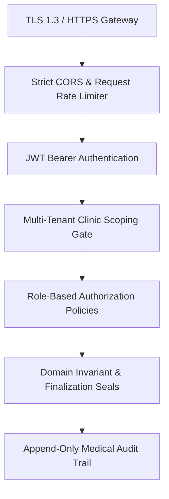

# MedCanvas Healthcare Security & Tenant Authorization Model

> **Document Status:** Security Architecture Specification  
> **Compliance Alignment:** HIPAA Security Rule / GDPR Health Data (Art. 9) / ISO 27799  
> **Threat Model:** Multi-tenant IDOR, credential stuffing, unauthenticated access, PHI logging leakage

---

## 1. Security Architecture Principles

Dental health records constitute sensitive **Protected Health Information (PHI)**. The MedCanvas backend enforces defense-in-depth across six distinct architectural layers:



---

## 2. Authentication & Token Management

### 2.1 JWT Bearer Token Architecture
- Issued via `POST /api/v1/auth/login` using cryptographic signature (HMAC-SHA256 with minimum 256-bit secret, or RSA-2048/ECDSA).
- Short expiration window: Access tokens expire in **60 minutes**; sliding refresh tokens stored securely.
- Mandatory Token Claims:
  - `sub`: Clinician / User unique GUID.
  - `email`: Normalized clinician email.
  - `clinic_id`: Active tenant clinic GUID for the session.
  - `role`: Assigned role within the active clinic (`Clinician`, `ClinicAdmin`, `Assistant`).
  - `jti`: Unique token identifier for replay protection.

---

## 3. Multi-Tenant Clinic Isolation (Anti-IDOR Defense)

### 3.1 The Threat: Cross-Clinic IDOR
In a multi-tenant clinic system, an attacker possessing credentials at Clinic A must never read, update, or enumerate patient charts belonging to Clinic B by guessing or manipulating UUIDs in the URL path.

### 3.2 Architectural Defense
1. **Tenant Context Injection**:
   - The ASP.NET Core DI pipeline injects `ICurrentUserContext` into application handlers.
   - `ICurrentUserContext` extracts `UserId` and `ClinicId` directly from the cryptographically verified JWT claims, never from user-supplied query strings or body parameters.
2. **Repository & Query Isolation**:
   - Every database query for patients, encounters, and odontograms includes an explicit predicate on `ClinicId`:
     ```csharp
     var odontogram = await _context.OdontogramRecords
         .FirstOrDefaultAsync(o => o.Id == request.Id && o.ClinicId == _userContext.ClinicId, cancellationToken);
     ```
3. **Information Disclosure Prevention**:
   - When a requested resource exists in the database but belongs to another clinic, the API returns `404 Not Found` (rather than `403 Forbidden`) to prevent unauthorized tenant enumeration of patient UUIDs.

---

## 4. Role-Based Authorization Policies (RBAC)

| Role | Permissions |
|---|---|
| **ClinicAdmin** | Manage clinic details, invite/remove users, manage billing, view clinic audit logs, view patients. |
| **Clinician** | Register patients, conduct encounters, author odontogram status and treatment plans, finalize clinical records, export FHIR bundles. |
| **Assistant** | View patient records and odontograms in read-only mode; record encounter notes; cannot finalize clinical records. |

### ASP.NET Core Policy Definitions:
- `Policy: RequireClinician` -> Requires role `Clinician` or `ClinicAdmin`.
- `Policy: RequireAdmin` -> Requires role `ClinicAdmin`.
- `Policy: RequireClinicMember` -> Validates caller has active membership in the requested `clinic_id`.

---

## 5. Protected Health Information (PHI) Logging & Redaction

### Strict Rules for Application Telemetry:
1. **No PHI in Standard Logs**:
   - Patient names, dates of birth, phone numbers, free-text clinical notes, and raw odontogram tooth payloads MUST NEVER appear in standard console or text log outputs.
2. **Safe Operational Identifiers**:
   - Logs record only non-sensitive operational metadata:
     `[INF] Odontogram updated for EncounterId: {EncounterId}, ClinicId: {ClinicId}, Duration: {ElapsedMs}ms`
3. **Sanitized Exception Handling**:
   - Stack traces and internal database connection strings are masked in production responses.
   - Exceptions return a sanitized RFC 7807 ProblemDetails payload with a correlation `traceId`.

---

## 6. Secure CORS Configuration

In the reference backend audit (`docs/backend/reference-audit.md`), the policy `SetIsOriginAllowed(_ => true).AllowCredentials()` was flagged as a severe vulnerability.

In MedCanvas, CORS is strictly locked down:
```csharp
builder.Services.AddCors(options =>
{
    options.AddPolicy("MedCanvasCorsPolicy", policy =>
    {
        var allowedOrigins = builder.Configuration
            .GetSection("Cors:AllowedOrigins")
            .Get<string[]>() ?? ["http://localhost:5173"];

        policy.WithOrigins(allowedOrigins)
              .WithHeaders("Authorization", "Content-Type", "If-Match")
              .WithExposedHeaders("ETag")
              .WithMethods("GET", "POST", "PUT", "DELETE", "OPTIONS")
              .AllowCredentials();
    });
});
```

---

## 7. Append-Only Medical Audit Trail

To meet legal healthcare accountability requirements:
- Every clinical record creation, update, deletion, finalization, or FHIR export triggers an append-only `ClinicalAuditEvent`.
- The database schema strictly prohibits `UPDATE` and `DELETE` operations on the `ClinicalAuditEvents` table via PostgreSQL table grant restrictions and EF Core interceptors.
- Audit event properties:
  - `Id` (uuid)
  - `ClinicId`, `PatientId`, `EncounterId`
  - `ActorUserId`
  - `Action` (`OdontogramCreated`, `OdontogramUpdated`, `OdontogramFinalized`, `FhirExported`)
  - `ClientIpAddress`
  - `TimestampUtc`
  - `DetailsHash` (SHA-256 integrity hash of payload)
