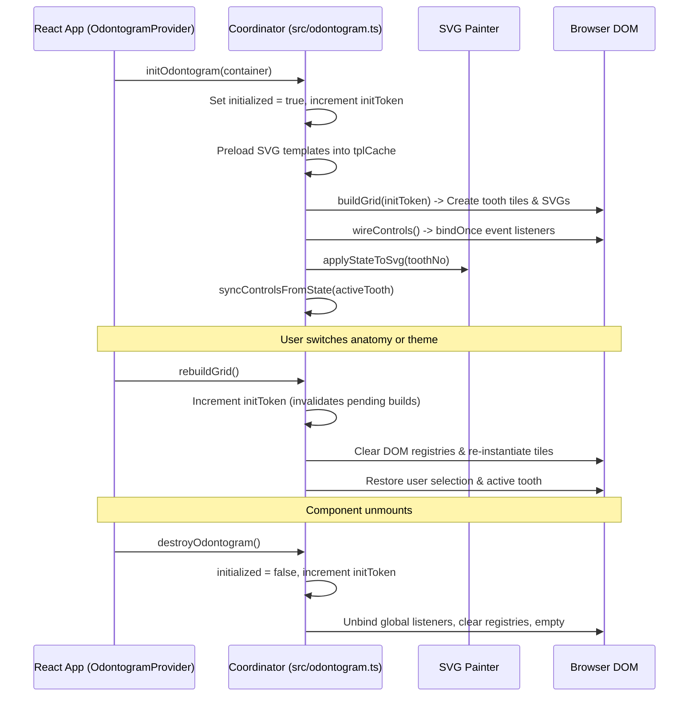

# Engine Lifecycle & DOM Coordination — Advanced Odontogram

## 1. Lifecycle Overview

The imperative odontogram engine manages the DOM lifecycle of interactive SVG teeth, periodontal probing cells, accessibility trees, and event handlers. It is designed to work safely inside React (including `React.StrictMode` double-mount environments) through idempotent binding, explicit teardown, and token-based async cancellation.



---

## 2. Core Lifecycle Functions

### 2.1 `initOdontogram()`
- **Purpose**: Initializes the charting engine and mounts the interactive SVG grid.
- **Workflow**:
  1. Checks if already initialized; guards against double-initialization.
  2. Increments `initToken` to invalidate any in-flight asynchronous operations.
  3. Preloads required SVG templates in parallel using `DOMParser`.
  4. Calls `buildGrid(token)` to instantiate the DOM structure.
  5. Runs `wireControls()` to attach event listeners idempotently.
  6. Subscribes to i18n locale updates and clinical warning notifications.
  7. Sets up resize observers for arch-spanning bridge connectors.

### 2.2 `destroyOdontogram()`
- **Purpose**: Fully tears down the engine, releases DOM references, and unbinds event listeners.
- **Workflow**:
  1. Sets `initialized = false` and bumps `initToken`.
  2. Removes delegated `document` click listeners (`onCardToggleClick`, `onGlobalToggleClick`).
  3. Unsubscribes from i18n and warnings handlers.
  4. Destroys touch gesture observers and clears `#toothGrid.innerHTML`.
  5. Clears all four core DOM registries: `toothSvgRoot`, `toothTile`, `toothLabelUpper`, `toothLabelLower`.
  6. Clears `pluginOverlays` map and resets selection/active tooth pointers.
  7. Empties dual-state charts and resets case-level metadata.

### 2.3 `rebuildGrid()`
- **Purpose**: Asynchronously regenerates the SVG grid following an anatomy profile change or layout reorganization, without losing user context.
- **Invariants**:
  - Preserves the currently selected teeth (`selectedTeeth`) and active tooth (`activeTooth`).
  - Clears stale DOM references from the registries **before** the asynchronous `buildGrid()` await, preventing in-flight access to detached nodes.
  - Checks `if (!initialized || token !== initToken) return;` after every `await` to safely discard builds superseded by rapid switching.
  - Re-applies selection UI and re-observes the bridge overlay after rebuilding.

### 2.4 `rewireControls()`
- **Purpose**: Re-attaches event listeners when React control surfaces mount or remount (e.g., switching view tabs or opening drawers).
- **Invariants**:
  - Fully idempotent: Uses `bindOnce` and populated-container guards so still-mounted nodes are left untouched and fresh nodes receive listeners.
  - Runs `syncControlsFromState()` on the active tooth to reflect current state.

---

## 3. Asynchronous Cancellation & Race Prevention (`initToken`)

Because SVG template parsing and anatomy profile loading are asynchronous, rapid user actions (such as toggling between Classic and Measured anatomy repeatedly) can schedule multiple overlapping builds.

To prevent race conditions and zombie DOM updates:
```typescript
let initToken = 0;

async function buildGrid(token: number) {
  if (!initialized || token !== initToken) return;
  // ... asynchronous template preloading ...
  await Promise.all(...);
  if (!initialized || token !== initToken) return;
  // ... DOM assembly ...
}
```
Any call to `destroyOdontogram()`, `rebuildGrid()`, or `setToothAnatomy()` increments `initToken`. If an older asynchronous build resolves after a newer build has started, the token mismatch triggers an immediate silent exit.

---

## 4. DOM Ownership & Core Registries

The coordinator maintains five module-scoped registries:

```typescript
const toothSvgRoot = new Map<number, SVGElement[]>();
const toothTile = new Map<number, HTMLElement[]>();
const toothLabelUpper = new Map<number, HTMLElement>();
const toothLabelLower = new Map<number, HTMLElement>();
const pluginOverlays: PluginOverlayRegistry = new Map();
```

### The Non-Alignment Invariant (CRITICAL)
> [!IMPORTANT]
> `toothSvgRoot` and `toothTile` are **NOT** index-aligned. Never attempt to zip or pair them by array position.

**Why they diverge**:
1. **Measured Anatomy Milk Teeth**: A tile for a milk-capable tooth (e.g. tooth 14) contains **two** SVG roots inside the same tile:
   - Root 1: Permanent tooth SVG (`data-variant="permanent"`)
   - Root 2: Deciduous milk tooth SVG (`data-variant="primary"`)
   `toothSvgRoot.get(14)` has length `2`, while `toothTile.get(14)` has length `1`.
2. **Posterior Teeth Occlusal Views**: Posterior molars and premolars possess both a `.tooth-tile.side-view` and a `.tooth-tile.occl-view`, adding roots to `toothSvgRoot` and tiles to `toothTile` at different counts.
3. **Lookup Rule**: To locate the tile owning an SVG element, use `svg.closest(".tooth-tile")`. To locate roots for a tooth, always iterate through `toothSvgRoot.get(toothNo)`.

---

## 5. Idempotent Event Binding (`bindOnce`)

Persistent JSX controls rendered by React are wired imperatively. Under `React.StrictMode` in development, React mounts, unmounts, and remounts components, which could cause duplicate event listeners on the same DOM element.

To guarantee per-element idempotency without global state flags:
```typescript
const wiredHandlers = new WeakMap<Element, Set<string>>();

function bindOnce(el: Element | null, type: string, handler: EventListener): void {
  if (!el) return;
  let set = wiredHandlers.get(el);
  if (!set) {
    set = new Set<string>();
    wiredHandlers.set(el, set);
  }
  if (set.has(type)) return;
  set.add(type);
  el.addEventListener(type, handler);
}
```
- Still-mounted elements retain their `Set` in the `WeakMap` and ignore duplicate binding attempts.
- Freshly mounted elements (new DOM instances) are absent from the `WeakMap` and are cleanly wired.
- Destroyed elements are automatically garbage-collected from the `WeakMap`.

---

## 6. Touch Gestures & Keyboard Navigation

- **Touch Support**:
  - `src/engine/gestures/touchGestures.ts` detects touch capability via `isTouchDevice()`.
  - Short tap: Displays the zoom popover for precise surface inspection.
  - Long press (> 500 ms): Opens the contextual action menu.
  - Touch move: Distinguishes intentional scrolling from tooth selection gestures.
- **Keyboard Navigation (WCAG 2.1 a11y)**:
  - Arrow keys (`ArrowLeft`, `ArrowRight`, `ArrowUp`, `ArrowDown`) navigate across the arch grid following clinical FDI sequencing (`src/engine/navigation/tileNavigation.ts`).
  - `Space` / `Enter`: Toggles selection of the active tooth.
  - Numbers `1`–`5`: Surface-level shortcuts for direct restoration/caries entry.
  - `Escape`: Deselects teeth or dismisses popovers.
